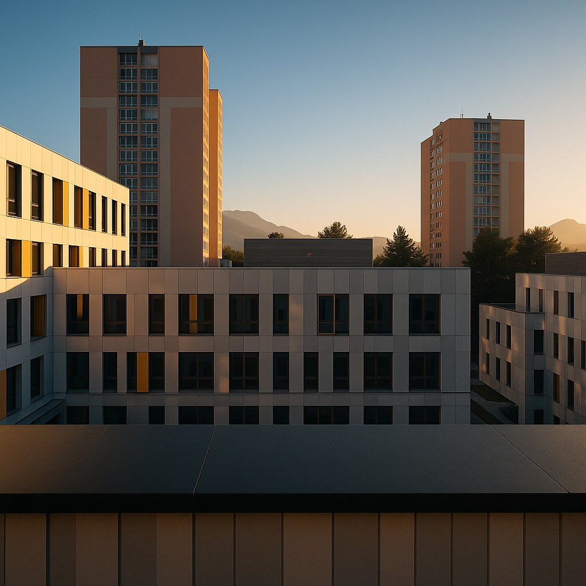

# Portfolio — Arthur Rouzeau (old)

Ancien portfolio technique, conservé pour consultation : réseau, sécurité et développement.

[Voir le site](https://rzu-it.github.io/rouzeau-portfolio.fr/)



HTML, CSS et JavaScript. 

## En local

```sh
python -m http.server 8000 --bind 127.0.0.1
```

Ouvrir http://127.0.0.1:8000/ depuis la racine du dépôt.

## Droits

Ce site est une démonstration de RZU Informatique. Consultation des sources autorisée ; merci de demander une autorisation avant de réutiliser le code, le design ou les contenus. Les éléments tiers conservent leurs droits et licences.
